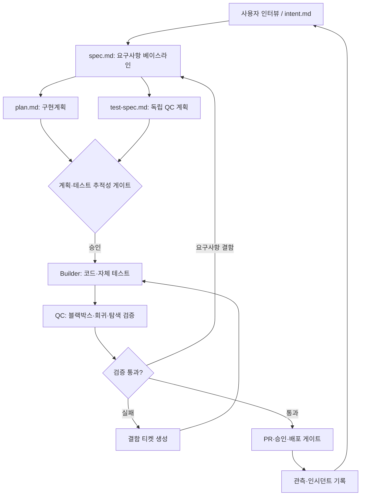

# VibeLabs AI-Native SDLC Harness — 설계 패키지 v1.0

**작성일:** 2026-10-26  
**목표:** 사용자의 의도부터 운영 피드백까지, 작성·검토·검증·승인 증거를 연결하는 에이전트 기반 개발 프로세스의 설계.  
**단계:** 연구/아키텍처/작업지시/템플릿(구현 완료 제품이 아님).

## 시작 위치

1. `docs/01_근거조사_문헌검토.md` — 논문·공식 가이드·기존 프레임워크 조사, 근거의 강도와 한계
2. `docs/02_전체_작업프로세스_SOP.md` — 단계별 SOP, 책임·게이트·되돌림·결함 관리
3. `docs/03_시스템_상세설계서.md` — 에이전트·상태기계·데이터 계약·권한·운영 설계
4. `docs/04_Claude_Code_작업지시서.md` — Claude Code에 그대로 전달하는 단계별 구현 지시
5. `docs/05_평가_검증_시나리오.md` — 시스템 자체 인수 테스트와 회귀 평가 설계
6. `templates/` — 모든 단계의 마크다운 산출물 템플릿
7. `examples/event-registration/` — 행사 신청 예시 산출물(일부)
8. `skills/sdlc/SKILL.md`(/sdlc 진입) · `skills/sdlc-*` · `agents/sdlc-*` — 구현된 스킬·에이전트 (아래 '구현 현황')
9. `docs/demo-walkthrough.md` — 빈 디렉터리에서 10~15분 데모

## 핵심 정의

- **Intent**: 사용자가 바라는 결과·제약을 설명한다. 구현 상세나 테스트 코드를 명령하지 않는다.
- **Spec**: 유일하게 식별 가능한 요구사항(REQ-ID), 경계조건, 시스템 계약을 기술한다.
- **Plan**: Spec을 만족하는 변경의 *방법*·순서·위험·대안을 기술한다.
- **Test Spec**: 구현 전 QC가 독립적으로 작성한 테스트 오라클(기대결과)과 검증 방법을 기록한다.
- **Traceability**: Intent → REQ → Plan Task → TC → Evidence → Defect의 연결을 보증한다.
- **Evidence**: 테스트 명령/환경/커밋/결과/아티팩트의 검증 가능한 기록이다.
- **Gate**: AI의 설명이 아닌, 정해진 규칙과 신뢰 가능한 실행 환경에서 판정하는 통과 조건이다.

## 흐름



## 지향점과 한계

- 목표는 인간을 배제하는 것이 아니라 **명세·위험·권한 결정에 인간의 개입을 집중**하는 것.
- 독립 QC의 의미는 **별도 컨텍스트/권한/테스트 오라클**로 분리하는 것이며, 같은 모델을 다르게 호출하는 것만으로 완전한 독립이 보장되지는 않는다.
- `.claude` 스킬·훅은 편의와 부분 통제 계층이다. **배포 승인과 코드 보호의 최종 강제력은 신뢰 가능한 CI, 브랜치 보호, 조직 관리 설정, 외부 승인 시스템**에 있어야 한다.
- 템플릿·샘플은 작업 착수를 위한 초안이다. 실제 배포나 운영 자격을 보증하지 않는다.

## 구현 현황 (로컬 MVP, 2026-10-26)

| 영역 | 상태 | 위치 |
|---|---|---|
| Phase 0 리포지터리 감사 | 완료 | `docs/repository-audit.md` |
| Phase 1 CLI·오프라인 검증기 (스키마·ID·추적성·기준선·승인 인터페이스·경로) | 구현·테스트 | `scripts/sdlc.py`, `scripts/validators/`, `schemas/` |
| Phase 2 진입 스킬 + 단계 스킬 8 + 에이전트 6 | 구현 (에이전트 행동은 EVAL-001/002/007/014 수동 평가 — **미검증**) | `skills/`, `agents/`, `.claude-plugin/` |
| Phase 3 QC 실행·RUN 증거·BUG 루프·재시도 예산·릴리스 체크리스트 | 구현·테스트 | `scripts/core/runner.py`, `bugs.py`, `release.py` |
| Phase 4 오라클 잠금·skip 탐지·가드 훅·CI 예시·evals | 구현·테스트 (보호 브랜치·CODEOWNERS 적용은 **미적용**, 권장안만) | `scripts/validators/tamper.py`, `scripts/hooks/`, `.github/workflows/`, `evals/` |
| M2 GitHub PR 리뷰 승인 검증(E2)·CI 체크·고위험 security 승인 | 구현·테스트 (가짜 API + 실제 레포 읽기 확인) | `scripts/validators/approvals.py`, `scripts/core/github.py`, `docs/github-integration.md` |
| 완전 자율 승인: GitHub App 봇 + 규칙 기반 `auto-approve` | 구현·테스트·**실제 GitHub e2e 통과** (PR #4: INTENT_DRAFT → RELEASE_APPROVED, 사람 승인 0) | `scripts/core/github_app.py`, `scripts/core/autoapprove.py`, `agents/sdlc-gatekeeper.md` |
| M2 버그 소통: GitHub Issue 동기화·댓글·보드 | 구현·테스트 (실제 레포에서 Issue 생성·댓글 확인) | `scripts/core/bugtracker.py` |
| 자동 배포·롤백 | 범위 밖 (명령 없음) | — |

### 설치 (Claude Code 플러그인)

```
/plugin marketplace add vibelabs-web/vibelabs-native-sdlc
/plugin install vibelabs-sdlc@vibelabs-sdlc
```

또는 터미널에서 한 줄 (Node 18+ — 위 두 줄을 대신 실행하고, `claude` 가 없으면 `~/.claude` 에 복사 설치):

```bash
npx github:vibelabs-web/vibelabs-native-sdlc
```

설치 후 `/vibelabs-sdlc:sdlc` 로 시작한다. 요구 사항: Python 3.10+, git. 개발용 심링크 설치·CLI 는 아래.

```bash
./install.sh                                  # 개발용: ~/.claude 에 심링크 (기존 항목 덮어쓰지 않음)
python3 scripts/sdlc.py --help
python3 -m unittest discover -s tests         # 하네스 테스트
python3 scripts/sdlc.py eval                  # EVAL-001~016
```

설치 `docs/installation.md` · 운영 `docs/operator-guide.md` · 설계 차이 `docs/implementation-decisions.md` · 보안 한계 `docs/security-limitations.md`

## 라이선스

MIT — `LICENSE`.
