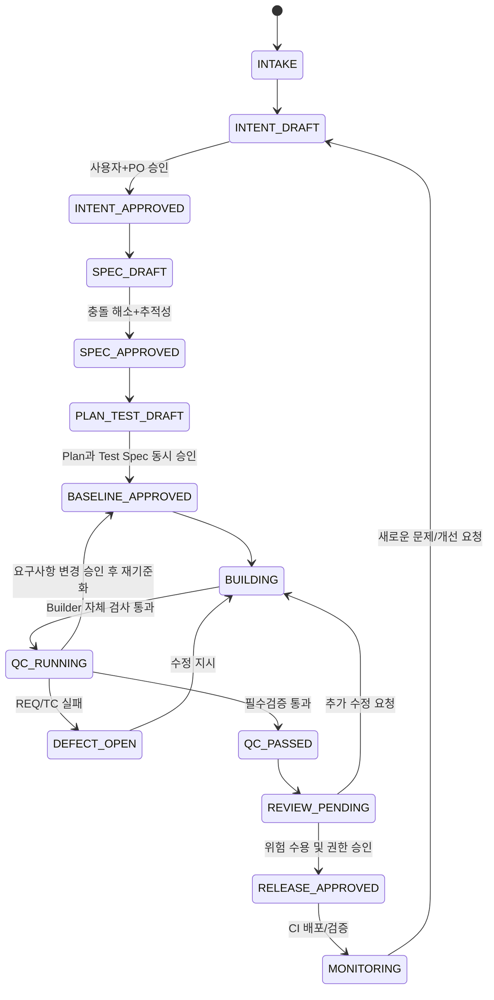

# 02. AI-Native SDLC 전체 작업 프로세스 및 표준 운영절차(SOP)

버전 1.0 / 2026-10-26  
핵심 원칙: **승인된 요구사항이 진실의 원천이고, 테스트 명세는 구현 전에 독립적으로 확정하며, 실패는 결함으로 추적하고, 단계 통과는 검증 가능한 증거로 판단한다.**

## 1. 적용 범위와 업무 등급

- **Lite (예: 문구 수정, 영향이 없는 문서 변경)**: Intent 간소화 + 영향 분석 + 린트/스모크. 보안/결제/개인정보 변경은 Lite 불가.
- **Standard (기본값)**: 모든 단계, 요구사항 ID, 사전 QC 테스트 명세, 자동 검증, 위험도 승인.
- **High-risk (인증·결제·개인정보·데이터 마이그레이션·규제)**: 추가 보안/정책 소유자 승인, 독립 테스트 환경, 변경 승인·롤백 연습. 인적 승인을 대체하는 자동화 금지.
- 위험도 판단 정보가 부족하면 Standard 또는 상위 등급으로 분류하고 확인한다.

## 2. 역할 및 책임(RACI 간략)

| 활동 | 최종 판단 책임 | 수행 | 독립 검증 |
|---|---|---|---|
| 문제·목표 확정 | 사용자/PO | Interviewer/Planner | Intent Auditor |
| 요구사항 기준선 | PO/정책 소유자 | Spec Agent | QC Architect |
| 구현 계획 | 기술 책임자 | Planner | QC Architect / Architect |
| 수용 테스트 오라클 | PO + QA 책임자 | **QC Architect** | Spec Agent (추적성만) |
| 코드 구현 | 기술 책임자 | Builder | 자체 테스트 + QC Verifier |
| 버그 종료 | QA 책임자 | Builder 수정 | **QC Verifier** 재검증 |
| 프로덕션 배포 | 지정된 운영 책임자 | CI/CD | Release Auditor |
| 장애 복구 결정 | 지정된 당직/운영 책임자 | 운영 자동화(승인 경로만) | 인시던트 감사 |

**분리 원칙**: Builder는 승인된 `test-spec.md`의 기대값·QC 소유 테스트를 수정하지 않는다. QC는 구현 코드를 직접 수정하지 않는다. 한 모델이 다른 역할로 호출될 수 있지만 컨텍스트·도구 권한·기준선은 분리한다.

## 3. 표준 상태 전이

규칙: `*_APPROVED`는 마크다운 문구만 보고 확정하지 않는다. 승인 원본(PR 승인/조직 승인 시스템)의 ID, 승인자, 시각, SHA/해시를 링크한다. Spec/Test Spec 기준선이 바뀌면 이후 계획/검증 증거는 자동으로 `stale` 처리하고 영향받는 게이트를 재통과해야 한다.

## 4. 단계별 운영카드

### 단계 0 — Intake & 분류

- **입력**: 자연어 요청, GitHub Issue, 인시던트, 변경 제안.
- **행동**: 기존 프로젝트 탐색; 기능 신규/개선/버그/장애 분류; 영향·위험·소유자·자료 접근권 확인.
- **산출물**: 변경 ID (`CHG-YYYYMMDD-NNN`), 유형/등급, 출처, 대화/티켓 링크.
- **게이트 G0**: 승인되지 않은 외부 시스템/기밀 데이터 접근 금지; 사용자 요청과 조직 정책 충돌 시 일시정지.

### 단계 1 — Discover → `intent.md`

- **선행 자료**: 기존 코드, 관련 버그, 사용자 메모, 정책(가능한 범위에서 먼저 확인).
- **대화 절차**: (1) 요청의 문제/결과 재진술 (2) 구현 차이를 야기하는 **최대 1~2개의 핵심 질문씩** (3) 답변마다 `confirmed / assumed / open` 태그 기록 (4) 오해 확인 및 초안 작성 (5) 사용자/PO 승인.
- **작성 항목**: Problem, Proposed outcome, Affected users/systems, Constraints, Open questions + 성공 신호·범위/비범위·출처·이해관계자·위험.
- **완료 조건 G1**: 문제·대상·바뀌어야 할 결과가 명료함; 미결정 사항에 책임자·마감/차단여부 있음; PO 승인 근거 있음.
- **재작업**: 모호한 목표는 질문 루프로. 구현 세부사항은 Spec으로 이관.

### 단계 2 — Specify → `spec.md` + `traceability.md`

- **입력**: 승인된 Intent, 정책, 기존 기능/아키텍처.
- **행동**: (1) 사용자 흐름/상태전이 모델 (2) REQ-ID별 한 가지 검증 가능한 규칙 (3) 정상·경계·음성·예외·동시성·권한·NFR (4) 사전/사후/불변조건 및 미정의 동작 명시 (5) 정책 충돌 처리 (6) 요구사항 품질 독립 검토.
- **완료 조건 G2**: 모든 핵심 의도에 REQ 매핑; 핵심 REQ가 측정 가능; 블로킹 모순 없음; 보안/정책 소유자 승인 필요항목 처리.
- **재작업**: 요청 자체가 틀리면 Intent, 세부 REQ 오류면 Spec 수정 후 새 베이스라인.

### 단계 3 — Plan과 Test Spec을 **병렬·독립 생성**

**Planner 트랙**
- 기존 코드 영향/변경 파일/API/모듈/DB/마이그레이션/작업 순서/위험·대안·복구안을 작성.
- TASK-ID를 REQ-ID에 연결하고 파일/인터페이스/완료증거를 선언.

**QC Architect 트랙**
- 같은 승인된 Spec에서 TC-ID별 Given/When/Then, 입력 데이터, 예상 관측값, 한계치, 테스트 형태, 실행 위치, 증거 형식을 설계.
- **구현 예정인 함수명이나 구현 코드에 종속된 오라클을 만들지 않는다.**
- 미정의된 동작을 발견하면 임의 기대값을 생성하지 않고 사양 결함으로 등록한다.

**Cross Review**
- 모든 필수 REQ에 TASK 및 TC가 존재하는지 표에서 확인. TC가 잘못된 계획을 그대로 승인하는 자기참조 문제를 방지하기 위해 QC는 Spec을 우선함.
- `plan.md`와 `test-spec.md` 버전을 같은 REQ baseline에 묶어 승인.
- **완료 조건 G3**: 필수 REQ의 계획·테스트 100% 매핑, 범위 밖 작업 없음, 필수 수용 조건의 기대값/오라클 명확, 계획·QC 승인 증거.

### 단계 4 — Build → 코드·자체 테스트

- **입력**: 고정된 Spec/Plan/Test Spec, 구현 대상 작업.
- **행동**: TASK 순서대로 구현 → lint/unit/integration/build → 자체 버그 수정 → 커밋·검증 로그 보존.
- **작성 산출물**: code diff, 변경 로그, 자체 테스트 결과, 구현된 TASK와 변경 파일의 대응표.
- **가드**: 잠금 테스트 수정 금지, secrets 접근 금지, 공개 전송/배포 금지, 계획 외 변경은 영향 확인 전 중지.
- **완료 조건 G4**: 예정된 TASK 처리, 로컬 정적/단위/빌드 검사 통과, SHA와 로그 기록, 자체 검증이 미충족 REQ를 은폐하지 않음.

### 단계 5 — QC & Defect Loop

1. QC는 새로운 컨텍스트/작업공간에서 **고정된 커밋 SHA**를 검증하고 Spec·Test Spec·Traceability를 읽는다.
2. TC 실행: 정상/경계/음성/보안/상태 전이. UI는 실제 브라우저/스크린샷·접근성 검증이 가능할 때 증거로 남긴다.
3. 독립 도전 테스트: 사전 고정 케이스 이외에도 반례·경쟁조건·무작위 표본(정해진 seed)을 추가한다. 새 반례는 재현성과 기대값이 검증된 후 회귀 자산으로 승격한다.
4. 실패면 `BUG-ID` 등록: 우선순위, REQ/TC, 전제 조건, 재현 스텝, 기대/실제, 환경, SHA, 로그, 증거 링크.
5. Builder만 구현 코드 수정. QC는 결과를 다시 검증하여 `verified_fixed` 또는 `reopened` 판정.
6. 관련 코드가 바뀌면 해당 테스트와 영향 회귀군을 **새 SHA에 대해** 다시 실행. 수정 후 기존 성공 증거 재사용 금지.
7. 동일 결함 3회 수정 실패(제안 기본값) 혹은 원인불명/Spec 충돌 시 자동 반복 중단, 담당자에게 위험·로그·추천 선택지로 에스컬레이션.
8. 검증 자체가 오류이면 QC가 사양의 기대값과 비교하여 정정 요청, QA 책임자 승인 후 Test Spec 새 버전 발급 및 전체 관련 재검증.

**결함 라이프사이클**: `open → triaged → in_progress → ready_for_retest → verified_fixed → closed` / 실패는 `reopened`; 요구사항 모순은 `blocked_spec`.

**완료 조건 G5**: 필수 요구사항별 통과 또는 승인된 예외(고위험 보안 항목 예외 금지), 미해결 blocker/critical=0, 근거 없는 `skipped`=0, 승인된 baseline과 테스트 SHA 일치, 독립 QC 보고서.

### 단계 6 — PR Review & Deploy

- **입력**: G5 QC 보고서, 전체 diff, 계획·승인·정책.
- **검토 축**: (A) `plan.md` 대비 불일치 (B) Spec/TC 대비 충족도 (C) 위험 범주와 승인자 (D) 보안/비밀정보·의존성·배포/롤백 준비.
- **완료 조건 G6**: CI required checks, 독립 리뷰, 변경 위험 수용 승인, 책임자 확인, 실행된 롤백/배포 런북.
- **권한 단계**: dev 자동 허용 범위 / staging 제한 범위 / production 지정 인간 승인. 정책은 리포지터리 관리자/CI 쪽에서 강제.
- **산출물**: PR, review.md, release.md, 배포 SHA/환경/검증/모니터링 링크.

### 단계 7 — Monitor & Learn

- **입력**: 실제 운영 지표, 인시던트 알림, 사용자 티켓.
- **행동**: 결정적 스크립트로 SLO/에러율 감지 → 읽기 전용 분석 → 승인 경로에 따라 대응 → 인시던트 기록 → 새 Intent와 회귀 평가 항목 생성.
- **산출물**: incident.md, 재발방지 액션, linked INT/REQ/TC, eval-case.
- **완료 조건 G7**: 복구 결과 및 사용자 영향 기록, 시간순 증거·승인 기록, 새 요구/테스트 소유자 지정.

## 5. 추적성 매트릭스: 완료의 기준

| Intent | REQ | TASK | TC | 실행 SHA | 결과/증거 | BUG | 판정 |
|---|---|---|---|---|---|---|---|
| INT-001 | REQ-001 | TASK-001 | TC-001 | `abc...` | `evidence/run-01.json` | - | PASS |
| INT-001 | REQ-002 | TASK-002 | TC-002 | `abc...` | `evidence/run-01.json` | BUG-001 | FAIL |

중요: **테스트의 통과 개수 ≠ 요구사항 완성률**. 요구사항 충족률은 `완료 증거가 있는 필수 REQ 수 / 전체 필수 REQ 수`로 표시하되, 하나라도 미검증/차단이면 배포 게이트를 실패하게 한다. 진실의 원본은 Markdown 숫자가 아니라 CI 로그/PR·리비전/승인 원본이다.

## 6. 문서 변경과 기준선 무효화

| 변경 | 무효화/재검토 대상 | 승인 주체 |
|---|---|---|
| `intent.md` 목표/제약 변경 | Spec/Plan/Test Spec 및 뒤 단계 전부 영향분석 | 사용자 + PO |
| `spec.md` 요구사항 변경 | Plan/Test Spec/TC/증거 새 baseline, 변경된 범위 재검증 | PO + 해당 정책 책임자 |
| `plan.md` 구현 방안 변경 | 위험·TASK/TC 관련성 재검토, 구현 승인 재확인 | 기술 책임자 |
| `test-spec.md` 기대값 변경 | 새로운 오라클 승인, 기존 QC 증거 폐기/재실행 | QA 책임자 + 필요한 PO |
| 코드 수정 | 새로운 SHA에 대해 관련 테스트+회귀 재실행 | Builder 실행 + QC 판정 |
| 스킬/훅/CLAUDE.md 변경 | 역사적 작업 eval을 이용한 행동 회귀 평가 | 프로젝트 소유자 |

## 7. 측정 지표

- **Leading**: 질문 횟수/수정된 Intent 비율; Spec의 미결정 차단 항목; REQ↔TASK↔TC 추적률; 독립 QC 첫 통과율; 결함의 평균 수정 루프; 검증 증거 최신성.
- **Lagging**: 요구사항 누락으로 생긴 재작업, 배포 후 결함 탈출률, 장애 복구 시간, 롤백 성공률, 테스트 오라클 수정율, 실패 재발률.
- 결과는 중요도별로 나누고 분모를 명시한다. 단순 테스트 개수/코드 줄 수를 품질 대용 지표로 취급하지 않는다.

## 8. 인적 개입 최소화 규칙

사람을 부르는 시점: (1) 사용자 목표 모호 (2) 필수 정책/보안 충돌 (3) 구현 범위를 바꾸는 설계 결함 (4) QC 오라클 변경 (5) 정해진 재시도 초과 (6) 고위험 변경 승인 (7) 프로덕션 배포/롤백 승인. 나머지 반복 가능한 작업은 에이전트 + 결정적 CI에 위임한다.

## 9. 최종 완료 정의(Definition of Done)

- 승인된 Intent/Spec/Plan/Test Spec 기준선 존재 및 해시/PR 근거.
- 핵심 요구사항의 상·하향 추적성 누락 0.
- 실제 커밋 SHA에 대한 테스트 실행 증거, 결함 처리 기록.
- Builder와 구분된 QC 검토 결과; 필수 REQ별 합격.
- 승인된 위험 수용, 필수 CI, 보호 브랜치 정책, 롤백 준비.
- 운영 시 발생한 문제는 Incident → 새 Intent/회귀 테스트로 연결.
