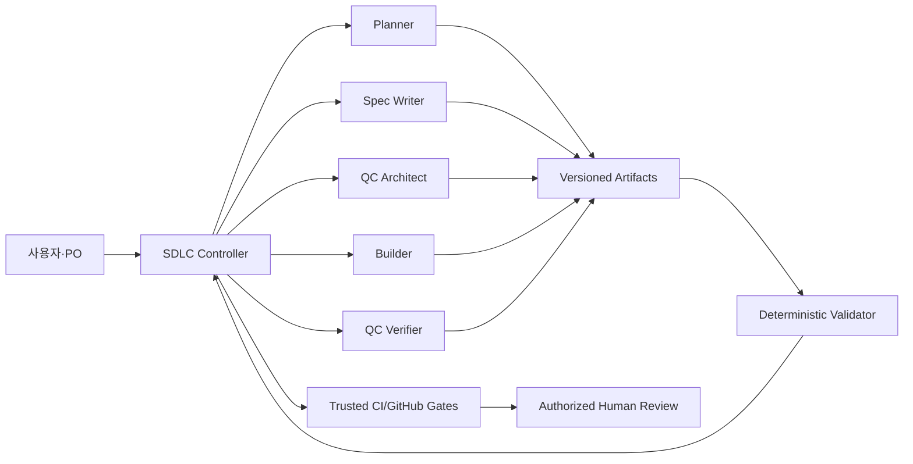

# 03. VibeLabs AI-Native SDLC Harness — 시스템 상세설계서

**상태**: 설계안(승인 전) · **대상**: Claude Code 우선, 추후 코딩 에이전트 교체 가능 · **배포**: MVP에서 자동 프로덕션 배포 없음.

## 1. 제품 비전

**목적:** 사용자의 자연어 의도를 소프트웨어 변경과 검증 가능한 증거로 변환하고, 서로 다른 역할의 AI가 문서/코드/결함을 인수인계하며, 중요한 결정만 사람이 승인하도록 지원한다.

**차별화:** 일반 SDD 도구 대비 (a) `test-spec.md`의 구현 전 독립 기준선, (b) REQ↔TASK↔TC↔Evidence 연결, (c) 수정/재검증 결함 티켓, (d) 단계별 승인과 기준선 변경의 무효화, (e) 운영 인시던트 재투입.

### 1.1 MVP 범위

- 프로젝트 단일 리포지터리; 텍스트/로컬 명령 중심. CLI를 통해 요청 접수 및 변경 ID 생성.
- Planner/Spec Writer/QC Architect/Builder/QC Verifier 역할을 Claude Code Skills+Subagents로 구성.
- 마크다운 및 JSON 스키마 검증; 변경 단위 상태 기록; 추적성 정적 검사.
- 테스트 수행·로그/증거 파일 작성; 결함 티켓 생성; 제한된 재시도 로직.
- Github Actions 단위의 필수 체크 예제. **실제 GitHub 브랜치 규칙과 승인 정책은 운영자가 설정**.

### 1.2 비범위

- 프로덕션 자동 배포/롤백, 실제 고객정보 접근, 인가되지 않은 원격 전송, 법규 적합성 인증.
- 테스트 통과에 의해 요구사항 자체가 참임을 증명한다는 주장.
- 모든 종류의 GUI 테스트 자동 지원; 브라우저 실행 환경이 없으면 수동/보류로 명확히 표시.

## 2. 논리 아키텍처



**SDLC Controller**는 문서 원본이 아니라 상태 전이의 조정자다. 게이트 판단에서 LLM 서술에 의존하지 않고 사전 정의된 규칙+증거를 검사한다. 임의 문서의 `status: approved`는 승인 증거가 아니며 외부 승인 토큰/PR ID 검증을 통해 처리한다.

## 3. 물리 구조(목표안)

```text
.claude/
  skills/sdlc/SKILL.md           # 단일 진입점 /sdlc
  skills/sdlc-intent/SKILL.md
  skills/sdlc-spec/SKILL.md
  skills/sdlc-plan/SKILL.md
  skills/sdlc-qc-design/SKILL.md
  skills/sdlc-build/SKILL.md
  skills/sdlc-qc-run/SKILL.md
  skills/sdlc-release/SKILL.md
  skills/sdlc-maintain/SKILL.md
  agents/planner.md
  agents/spec-writer.md
  agents/qc-architect.md
  agents/builder.md
  agents/qc-verifier.md
  agents/release-auditor.md
  settings.json                 # 개발 편의 훅; 최종 권한은 외부 강제
.sdlc/
  policies/                     # 보안/개인정보/품질 버전 관리
  changes/CHG-.../
    intent.md
    spec.md
    plan.md
    test-spec.md
    traceability.md
    decisions.md
    state.json
    issues/BUG-001.md
    evidence/RUN-001.json
    qc-report.md
    review.md
    release.md
    incident.md
  evals/                        # 역사 과제 기준선 / 에이전트 설정 회귀 평가
scripts/
  sdlc.py                      # CLI: new, inspect, validate, gate, report
  verify_schema.py
  verify_traceability.py
  verify_evidence.py
  guard_paths.py
.github/workflows/
  sdlc-validate.yml
CLAUDE.md
```

## 4. 역할 계약과 권한 분리

| 역할 | 읽기 | 쓰기 | 금지 | 출력 |
|---|---|---|---|---|
| Interviewer/Planner | 코드·Issue·Intent | `intent.md`, `plan.md` 초안 | 임의 승인/배포 | 질문·의도·계획 |
| Spec Writer | 승인된 Intent·정책 | `spec.md`, 매핑 초안 | 정책 충돌 무시 | REQ 계약 |
| QC Architect | 승인된 Intent·Spec, 정책 | `test-spec.md`, QC 검토 | 구현 코드 수정/기존 정답을 코드에 맞춰 수정 | TC·오라클·누락 분석 |
| Builder | 승인된 산출물·코드 | 코드·자체 테스트·구현 로그 | QC 소유 테스트/기준선 무단 변경 | diff·빌드 증거 |
| QC Verifier | 고정 SHA의 코드·Spec·Test Spec | QC 보고서·이슈·격리된 테스트 결과 | 제품 코드 수정/승인 위조 | Pass/Fail·재현 증거 |
| Release Auditor | Plan/Spec/QC/CI | 승인 요청 초안·리뷰 | 배포 승인 대리 | 위험 요약 |

**중요 현실 제약:** Claude Code 서브에이전트의 `tools: Read, Glob, Grep`는 편의적인 읽기 전용 지침이지만, 해당 에이전트가 생성한 텍스트를 상위 에이전트가 파일에 쓰게 할 수 있다. 또 권한이 강한 프로세스가 파일을 직접 변경할 수도 있다. 강한 격리를 원하면 **별도 작업 공간, filesystem 권한, 보호 브랜치, CI, 승인 시스템**을 병행한다.

## 5. 아티팩트 계약

### 5.1 작성 규칙

- 파일명은 안정적이고 변경 폴더(`change_id`)로 버전을 구분한다. 실제 버전은 Git commit SHA로 식별한다.
- 모든 최상위 산출물에 `change_id`, `revision`, `status`, `author_role`, `source_refs`, `approval_ref`(미승인 시 null)를 기록한다.
- Markdown 본문은 사람을 위한 설명, ID 표는 기계적 검사를 위한 관계 표현. 엄격한 자동 판정은 JSON/CSV 등 구조화된 인덱스로 수행 가능하게 한다.
- `REQ-001`, `TASK-001`, `TC-001`, `BUG-001`, `RUN-001`, `INC-001` 식별자는 삭제 후 재사용하지 않는다.
- 사실/관찰/가정/제안을 구분한다. 정보가 없으면 `미확인`이라고 쓴다.
- 기술적 세부 구현과 결함 수정이 Spec의 기대 결과를 변경할 수 없다. 필요시 정식 변경 요청.

### 5.2 필드별 필수 내용

| 파일 | 필수 항목 | 게이트 기준 |
|---|---|---|
| `intent.md` | 문제, 결과, 대상/시스템, 제약, 열린 질문, 성공 신호, 출처 | G1: 결과와 제약 이해/승인 |
| `spec.md` | REQ-ID, 조건, 관측 가능한 동작, 경계/예외, 비기능·정책, 불확실성 | G2: 명세 누락/충돌 제거 |
| `plan.md` | TASK-ID, REQ 연결, 파일/순서/위험/대안/증거/롤백 | G3: 구현 가능성/추적률 |
| `test-spec.md` | TC-ID, REQ 연결, Given/When/Then, 오라클, 방법, 재현 환경 | G3: 구현 전 합격 기준 승인 |
| `traceability.md` | INT/REQ/TASK/TC/RUN/BUG 관계 | G3/G5: 필수 관계 완결 |
| `qc-report.md` | spec/test/hash 버전, 실행 범위, PASS/FAIL/SKIP, 결함 | G5: 기준 일치/차단 결함 0 |
| `review.md` | diff↔plan, 위험, 승인, CI 검증 | G6: 승인 원본 참조 |
| `release.md` | 버전, 배포/롤백 런북, 실제 승인자·시각·환경 | G6: 운영 통제 |
| `incident.md` | 관측/영향/타임라인/원인/복구/학습/신규 intent | G7: 운영 피드백 폐루프 |

### 5.3 상태 JSON 예시(설계안)

```json
{
  "schema_version": "1.0",
  "change_id": "CHG-20261026-001",
  "stage": "QC_RUNNING",
  "risk_level": "standard",
  "baselines": {
    "intent_git_sha": "<40-char SHA>",
    "spec_git_sha": "<40-char SHA>",
    "plan_git_sha": "<40-char SHA>",
    "test_spec_git_sha": "<40-char SHA>"
  },
  "approvals": {
    "intent": "https://github.com/org/repo/pull/123#pullrequestreview-...",
    "plan_test": "https://github.com/org/repo/pull/124#pullrequestreview-..."
  },
  "last_verification_run": "RUN-001",
  "retry_budget": {"per_defect": 3},
  "blocked_reasons": []
}
```

중요: 값이 채워졌다는 사실은 진위 검증이 아니다. `gate` 명령은 승인 참조의 실재성과 승인자 권한/커밋 일치 여부를 신뢰 시스템에서 확인해야 한다. **오프라인 MVP에서는 승인 진위 검증 불가 시 `manual_verification_required`로 실패-안전 처리**한다.

### 5.4 테스트 실행 증거 JSON(제안)

```json
{
  "run_id": "RUN-001",
  "change_id": "CHG-20261026-001",
  "commit_sha": "<full-sha>",
  "spec_sha": "<full-sha>",
  "test_spec_sha": "<full-sha>",
  "environment": "isolated-ci-linux",
  "started_at": "2026-10-26T01:00:00Z",
  "commands": [{"cmd":"pytest -q", "exit_code":0, "log_path":"evidence/pytest.log"}],
  "cases": [{"tc_id":"TC-001","result":"PASS","evidence":"evidence/tc001.json"}],
  "verifier_role": "qc-verifier",
  "report_sha256": "<digest>"
}
```

**증거 신뢰도 등급**: (E0) AI의 말만 있음(게이트 불가) → (E1) 명령 로그 (E2) 신뢰 CI 실행과 커밋 연동 (E3) 독립 검증+재현 가능한 실행환경/승인. 사용자의 합격 결정은 최소 E2 + 주요 REQ E3를 권고.

## 6. 의사결정 및 테스트 설계 규칙

### 6.1 사용자 인터뷰 스코어링(질문 최적화)

`질문 우선순위 = 영향도 × 불확실성 × 되돌리기 비용`(정량 지표가 아닌 정렬 휴리스틱). 영향이 큰 미결정 항목을 앞에서 1~2개씩 질문한다. 단순 색상/문구 등의 저위험 사항은 가정으로 기록하되 사용자 승인 없이 요구사항이 되지 않는다. 질문 중단: 핵심 결과·제약·사용자·차단 질문이 해결되고 Intent가 검토 가능한 수준일 때.

### 6.2 명세 검증

모든 핵심 REQ에 관측 가능한 사후조건을 기록하고 다음을 질문한다: 기능 누락? 허용되지 않은 경로? 경계값? 부정 케이스? 동시성? 예외 처리? 모호한 정책? 충분하지 않으면 `OPEN-xxx` 생성.

### 6.3 독립 QC 설계

- **먼저 계약, 그다음 테스트:** QC는 Spec을 기반으로 기대 결과/불변조건을 먼저 작성한다.
- **공개 테스트/비공개 수용 테스트 구분:** 구현자는 요구사항과 공개 TC를 읽을 수 있지만, 최종 수용용 무작위 테스트 입력·별도 회귀 세트는 QC/CI에서 관리한다. 단, 비공개 테스트가 사용자에게 숨겨진 새 요구사항이 되어서는 안 된다.
- **오라클 관리:** 차단되는 보안·정합성·돈/인원수 규칙은 결정적 assert로 확인한다. UI 디자인처럼 일부 주관적 판단은 스크린샷+사람 검토를 병행한다.
- **테스트 누수 방지:** Builder는 QC 소유 테스트에 쓰기 권한 없음. CI에서 승인되지 않은 테스트 삭제/약화/skip을 감지한다.
- **무한 루프 방지:** 결함당 최대 3회 자동 수정 기본값, 동일 증상 반복 또는 검증 환경 실패 시 사람에게 에스컬레이션.

## 7. 게이트 판단 알고리즘(의사코드)

```python

def gate(change, next_stage):
    baseline = load_and_validate_schema(change)
    assert not baseline.has_unresolved_blockers()
    assert approval_store.verify_required_approvals(change, next_stage)  # 외부 신뢰 시스템
    assert traceability.has_required_edges(change)
    if next_stage in ("QC_PASSED", "REVIEW_PENDING"):
        evidence = load_ci_evidence(change)
        assert evidence.commit_sha == change.current_commit_sha
        assert evidence.spec_sha == baseline.spec_sha
        assert evidence.test_spec_sha == baseline.test_spec_sha
        assert evidence.all_must_requirements_verified()
        assert evidence.blocking_defects == 0
    return "ALLOW"
```

자동 판정할 수 없는 항목이나 외부 통합이 없는 상황은 `BLOCK/MANUAL_REVIEW_REQUIRED`로 처리하고 절대로 추정 승인하지 않는다.

## 8. 실패 분류와 복귀 경로

| 오류 유형 | 예시 | 처리 |
|---|---|---|
| 요구 오류 | 대기자 정책 불명 | `intent/spec` 재논의 → 기준선 갱신 |
| 계획 오류 | DB 트랜잭션 처리 누락 | `plan` 재작성 → 영향 TC 확인 |
| 구현 오류 | 동시성 제한 미준수 | BUG 발행 → Builder 수정 → QC 재실행 |
| 테스트 오류 | 기대값이 승인 Spec과 다름 | 테스트 오라클 이슈 → QA/PO 승인 변경 |
| 환경 오류 | DB/브라우저 가동 실패 | INFRA로 분류, PASS 간주 금지 |
| 불안정 테스트 | 재실행마다 결과가 달라짐 | FLAKY 분류, 격리/원인 해결, 임의 skip 금지 |
| 정책 충돌 | 사내 데이터 해외 전송 요구 | BLOCKED, 정책 책임자 결정 요청 |
| 승인 불일치 | 변경된 SHA에 이전 승인 사용 | 승인 무효화, 재리뷰 |

## 9. 배포/보안 아키텍처

- Skill: 작업 방식을 안내하는 **소프트 제약**.
- Hook: Tool 이벤트 검사/차단의 **프로세스 수준 제약**. 샌드박스 외의 모든 경로를 막는 보안 경계로 과신하지 않는다.
- Managed permissions: 조직 단위 공통 제한(관리자 소유).
- CI+branch rules: PR의 요구 체크·CODEOWNERS·승인·배포 토큰 접근을 통제하는 최종 강제 경계.
- 비밀정보는 `.sdlc/evidence`에 남기지 않는다(마스킹/보존기간/허용 리포지터리 정책 필요).
- 파생된 로그/대화에는 고객·기밀 자료가 들어갈 수 있으므로 저장/반출 승인 필요.
- 외부 API, 배포, DB 마이그레이션, 운영 롤백은 사용자/조직에서 명시적 승인한 범위 외 수행 금지.

## 10. 구현 우선순위

**M0:** 산출물 템플릿, 경량 Skills, 독립 QC 에이전트, 오프라인 스키마/추적성 확인.  
**M1:** 고정 커밋 증거, BUG 루프/재시도 제한, 변조 방지 체크, 회귀 테스트.  
**M2:** GitHub PR/필수 체크/승인 이벤트 연동, 위험 기반 게이트.  
**M3:** 모니터링/인시던트 이벤트/런북(별도 보안 감사 후 도입).

## 11. 사전 검증 질문

1. Spec의 REQ는 사용자 목표와 출처에 연결되어 있는가?
2. QC가 Builder 소스 없이도 합격·불합격을 판정할 수 있는가?
3. 코드 없이도 TC의 기대값이 명백한가?
4. 한 REQ가 누락되면 전체 테스트 수가 많아도 실패하는가?
5. 테스트를 삭제하거나 기대값을 낮추면 보호된 CI에서 탐지되는가?
6. 코드가 바뀌면 이전 성공 로그가 폐기되는가?
7. 동일 결함이 반복되면 인간 개입으로 빠져나오는가?
8. 승인자 없는 프로덕션 요청이 실패하는가?
9. 인시던트가 새 요구와 회귀 테스트로 돌아오는가?
